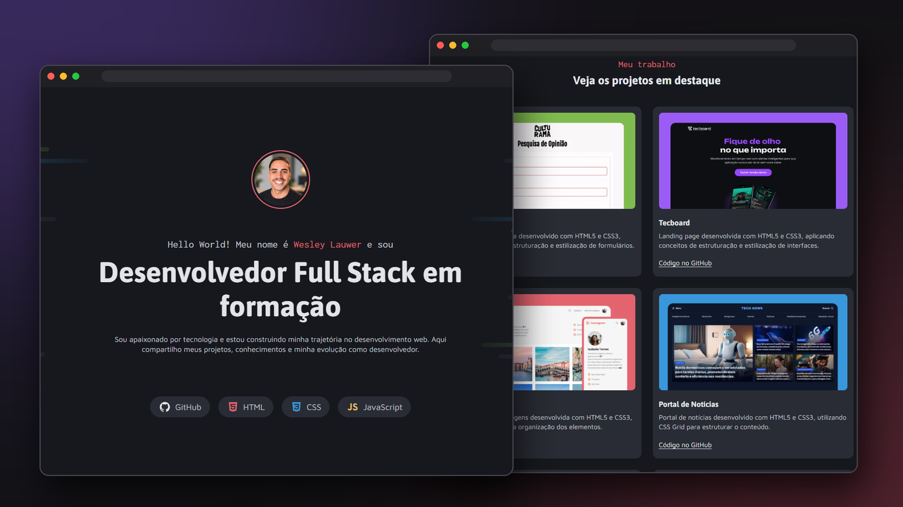

<h1 align="center">Portfólio Dev — Wesley Lauwer</h1>

<p align="center">
  Meu portfólio pessoal como desenvolvedor, construído a partir do desafio prático <strong>Portfólio Dev</strong> da formação Full Stack da Rocketseat.
</p>

<p align="center">
  
  
  
  
  
</p>

<p align="center">
  <a href="#-sobre-o-projeto">Sobre</a> •
  <a href="#-funcionalidades">Funcionalidades</a> •
  <a href="#-tecnologias">Tecnologias</a> •
  <a href="#-como-rodar">Como rodar</a> •
  <a href="#-estrutura">Estrutura</a> •
  <a href="#-versões">Versões</a> •
  <a href="#-aprendizados">Aprendizados</a>
</p>

<p align="center">
  
</p>

---

## 💜 Sobre o projeto

Este projeto nasceu como um **desafio prático da Rocketseat**, que propõe construir um portfólio em HTML e CSS a partir de um layout no Figma.

Em vez de entregar um portfólio fictício, usei o desafio para criar **o meu portfólio real**: com a minha apresentação, as tecnologias que estou estudando, os projetos que já desenvolvi e as formas de entrar em contato comigo.

> **Projeto autoral.** O layout base é da Rocketseat; a implementação, o conteúdo e as melhorias com JavaScript foram feitos por mim, sem acompanhar aula.

🔗 **Deploy:** [lpwesley.github.io/lauwer-dev-portfolio](https://lpwesley.github.io/lauwer-dev-portfolio/)

---

## ✨ Funcionalidades

**Versão 1 — HTML e CSS (entrega do desafio)**
- [x] Seção de apresentação com foto, título, descrição e habilidades
- [x] Tags das tecnologias que fazem parte da minha stack
- [x] Seção de projetos em destaque com cards (imagem, nome e descrição)
- [x] Seção "Como posso ajudar o seu negócio" com meus serviços
- [x] Seção de contato com links para redes sociais
- [ ] Layout responsivo (adaptado por mim, já que o Figma traz apenas a versão desktop)

**Versão 2 — Melhorias com JavaScript**
- [ ] Cards de projetos renderizados a partir de um array de objetos
- [ ] Filtro de projetos por tipo: **autoral** / **guiado** / **cliente**
- [ ] Menu de navegação para telas pequenas
- [ ] Animações de entrada ao rolar a página
- [ ] Botão de copiar e-mail para a área de transferência

> O site continua funcionando sem JavaScript: o JS entra apenas como camada de melhoria.

---

## 🚀 Tecnologias

- **HTML5** — estrutura semântica
- **CSS3** — variáveis, Flexbox, Grid, media queries e `@font-face`
- **Fontes locais** — Asap, Inconsolata e Maven Pro
- **JavaScript** — manipulação do DOM *(em breve, na versão 2)*
- **Figma** — layout de referência
- **Git e GitHub** — versionamento

---

## 💻 Como rodar

Não é preciso instalar nada, o projeto é estático.

```bash
# 1. Clone o repositório
git clone https://github.com/lpwesley/lauwer-dev-portfolio.git

# 2. Entre na pasta
cd lauwer-dev-portfolio

# 3. Abra o index.html no navegador
```

Dica: no VS Code, a extensão **Live Server** recarrega a página automaticamente a cada alteração.

---

## 📁 Estrutura

```
lauwer-dev-portfolio/
├── assets/
│   ├── icons/                  # ícones das tecnologias, serviços e redes sociais
│   ├── images/                 # foto de perfil e imagens dos projetos
│   └── preview-portfolio.png   # print usado neste README
├── css/
│   ├── style.css               # arquivo principal, importa os demais
│   ├── global.css              # reset, variáveis, fontes e estilos base
│   ├── header.css              # seção de apresentação
│   ├── projects.css            # seção de projetos em destaque
│   ├── services.css            # seção de serviços
│   └── footer.css              # seção de contato
├── fonts/
│   ├── Asap-Bold.ttf
│   ├── Inconsolata-Regular.ttf
│   └── MavenPro-Regular.ttf
├── index.html
└── README.md
```

O CSS foi dividido por seção para facilitar a manutenção: cada parte da página tem seu próprio arquivo. Na versão 2, entra a pasta `js/` com o `main.js`.

---

## 📌 Versões

| Versão | Descrição | Status |
|--------|-----------|--------|
| `v1.0` | Entrega do desafio: HTML e CSS fiéis ao layout, com meu conteúdo | 🚧 Em andamento |
| `v2.0` | Melhorias com JavaScript e responsividade completa | 📋 Planejada |

A versão entregue à Rocketseat fica marcada com a tag `v1.0` no Git, para que seja possível comparar a evolução do projeto.

---

## 📚 Aprendizados

<!-- Preencha ao longo do desenvolvimento: o que foi difícil, o que você aprendeu, o que faria diferente. -->

- Transformar um layout do Figma em código, respeitando espaçamentos, cores e tipografia
- 
- 

---

## 🎨 Créditos

- Layout original: desafio **Portfólio Dev**, da [Rocketseat](https://www.rocketseat.com.br/)

---

## 👋 Contato

Feito por **Wesley Lauwer**, estudante de Análise e Desenvolvimento de Sistemas e de Ciência da Computação, em formação Full Stack.

[](https://www.linkedin.com/in/wesleylauwer)
[](https://github.com/lpwesley)
